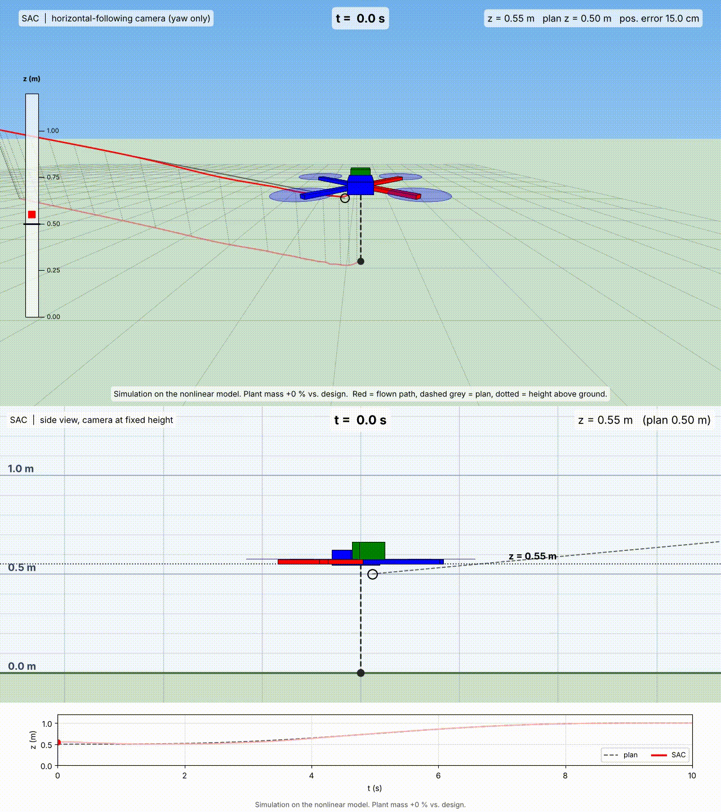

# Quadcopter Trajectory Tracking with Simple Adaptive Control (SAC)

## Overview

This project implements an **Adaptive Command Generator Tracker (ACGT)**, a Simple Adaptive Control (SAC) method from the family of Direct Model Reference Adaptive Control (DMRAC), for quadcopter trajectory tracking. Research papers show that its robust and adaptive nature makes it more tolerant to disturbances, inaccuracies, and uncertainties [1].



> **Headline result.** Under a +40 % mass error, SAC (designed with the nominal mass) ends within about 0.03 m of the plan, on par with PID and LQI, while time-varying LQR without integral action ends about 0.39 m off. Getting there required a washout compensator on z and ψ; see [Compensator design](#compensator-design) and [Results](#results).

**Approach**

1. **Trajectory.** A 7th-order polynomial plan with zero velocity, acceleration and jerk at the start and end. It is sampled into 200 points, and the reference states and inputs `(Xr, ur)` come from differential flatness.
2. **Model.** The full nonlinear quadcopter model is derived symbolically and linearized with Jacobians at each of the 200 samples. This gives a linear time-varying (LTV) description of the deviation `X − Xr`, with the linear model held fixed over each segment.
3. **Compensator.** SAC is only guaranteed to work if the plant is *almost strictly positive real* (ASPR): minimum phase, relative degree one, and a symmetric positive definite `CB`. The quadcopter's position channels have relative degree 4 (x, y) and 2 (z, ψ), so a parallel feedforward compensator `H(s)` is added, and the pipeline designs it. The ASPR conditions are then checked at every frozen segment.
4. **Control.** The SAC drives the output deviation to follow a reference model. It is validated on the **nonlinear** plant with actuator saturation, not only on the linearization.
5. **Benchmark.** All controllers share the same plan, initial offset, actuator limits and metrics, and are tested with a nominal design on a perturbed plant.

## Pipeline and method

The scripts run in this order and pass data through the base workspace.

| Step | File | What it does |
|---|---|---|
| 1 | `Nonlinear_Sym.m` | 12-state model (Euler angles, linear drag, body-rate dynamics incl. gyroscopic term). Symbolic Jacobians `A_sym`, `B_sym`. |
| 2 | `trajectory_generation.m` | 7th-order polynomial flat outputs (x, y, z, ψ). Thrust and Euler angles from the thrust direction, rates and torques by differentiation. Gives `Xr`, `ur`, `tt`. |
| 3 | `linearize.m` | `A_k`, `B_k` at the 200 plan samples. Generates and caches numeric functions (`A_fun_gen`, `B_fun_gen`, `f_fun_gen`). Checks that `f(Xr,ur) = dXr/dt`. |
| 4 | `new_compensator.m` | Signed-permutation input alignment `E_u`, analytic design of the parallel feedforward compensator `H(s)` (washout on z and ψ), ASPR checks (minimum phase, `CB` symmetric positive definite) at every frozen sample. |
| 5 | `run_sac.m` | Closed-loop SAC (RK4, saturated inputs) on the nonlinear plant or the LTV plant. |
| 6 | `baseline_sim.m` | PID (cascaded), time-varying LQR, LQI on the same plan, limits and initial offset. |
| 7 | `sweep_all.m` | Wrong mass / inertia / drag sweep for all four controllers (nominal design, perturbed plant). |
| – | `calc_metrics.m` | Same metrics for every controller (rms / max / final position error, angle error, input effort). |
| – | `run_all.m` | Runs steps 1-5 (and optionally the sweep) in the right order and saves figures. |

### Compensator design

The plant has relative degree 4 (x, y) and 2 (z, ψ), so it is not ASPR. A diagonal parallel feedforward compensator `H(s)` is added so that `Ga = Gp + H` has relative degree 1, is minimum phase and has `CB > 0`.

- **x and y:** `H` is designed analytically to place all zeros of `Ga` at `−q`.
- **z and ψ:** `H = d·s/(s+σ)²` is a **washout** (`H(0) = 0`). A plain first-order `H = d/(s+σ)` also makes `Ga` ASPR, but its DC gain turns every persistent control effort into a steady-state tracking error (see [Results](#results)).

> The ASPR conditions are verified on **frozen-time** LTI plants only. They do not prove stability of the time-varying nonlinear closed loop.

### SAC law

With reference model `y_m`, augmented error `e_y = y_m − (y_p + y_h)` (where `y_h` is the compensator output) and regressor `r_x = [e_y; x_m; r]`:

```
ũ  = e_y · (r_xᵀ Γp r_x) + K_i r_x
K̇_i = e_y r_xᵀ Γi − σ K_i
u  = sat( u_r + E_u ũ )
```

Here `x_m` is the reference-model state, `u_r` the planned input, `E_u` the input alignment, `Γp` and `Γi` the adaptation gains, `σ` the leakage and `sat` the actuator limits. The command channel `r` is implemented (`cmd_amp` in `run_sac.m`) but set to zero in all results here, so the loop simply follows the plan `Xr`.

## Quick start

Requirements: MATLAB with **Symbolic Math Toolbox** and **Control System Toolbox** (`lqr`, `tf`, `ss`). Developed on MATLAB `R2016a`.

```matlab
% from the repo root
run_all                       % steps 1-5, saves figures to figures/results/
```

Options are at the top of `run_all.m`:

- `ra.run_sweep = true` also runs the mismatch sweep (takes minutes).
- `ra.force_regen = true` rebuilds the generated `*_fun_gen.m` files.

The generated files `A_fun_gen.m`, `B_fun_gen.m`, `f_fun_gen.m` are git-ignored and rebuilt on the first run. Run the scripts from the repo root, since the generated files are written to the current folder.

To run steps manually: `Nonlinear_Sym → trajectory_generation → linearize → new_compensator → run_sac`, then `sweep_all` (it needs the base-workspace variables from the earlier steps).

## Results

Setup: 10 s plan from (0, 0, 0.5) m to (2, 5, 1) m with a 90° yaw turn, initial offset (0.10, −0.10, 0.05) m, thrust limited to `[0, 2mg]`, torques to ±1 N·m (±0.5 for yaw), nonlinear plant.

### Nominal tracking (SAC)

| | |
|---|---|
|  |  |

- Position error converges to zero by about 5 s and stays there.
- Between about 1.7 s and 3.5 s there is an oscillation burst in roll and pitch, up to about ±0.18 rad (≈ ±10°), with the yaw torque hitting its limit.

### Model mismatch (SAC vs PID / LQR / LQI)

Nominal design, perturbed plant (+10 / 20 / 40 %), one parameter group at a time.

**With a first-order compensator on z and ψ (`H(0) = 0.25`)**


**With the washout compensator (`H(0) = 0`)**


- **Wrong mass, before.** SAC had the largest steady-state error (about 0.25 m at +10 %, about 1 m at +40 %), worse than LQR.
- **Wrong mass, after.** The final error drops to about 0.005 m at +10 % and about 0.03 m at +40 %, on par with PID and LQI. LQR is now the worst (about 0.39 m at +40 %), as expected without integral action. In rms error SAC (about 0.18 m at +40 %) is still behind LQI (about 0.13 m) and PID (about 0.10 m), which is probably the time the adaptive integral gain needs to build up.
- **Wrong inertia / wrong drag.** All controllers stay within about 1 mm (inertia) and 15 mm (drag) of final error. The rms values (about 0.033–0.040 m) are dominated by the initial-offset transient, so these two cases are weak discriminators.

**Why the first-order `H` biased the mass case.** SAC drives the augmented error `e_y = y_m − (y_p + y_h)` to zero, not the true error `y_m − y_p`. At steady state `y_m − y_p = y_h = H(0)·ũ_ss`, where `ũ_ss` is the steady-state virtual input. A wrong mass requires a constant extra thrust forever (`ΔT = δ·m·g`), so `y_h` stays nonzero and the plant is held away from the reference. With `H_z(0) = 0.25` the predicted offset at +10 % is about 0.25 m, matching the sweep. The washout removes the DC gain, so the offset disappears. Raising the adaptation gains could not have fixed it, because the offset depends on `H(0)` and the physics, not on the gains.

## Known issues

- **Residual mass offset.** About 0.03 m remains at +40 % mass. Likely causes are the leakage `σ` on `K_i` and finite convergence time. Not yet tested: a smaller leakage or a longer horizon.
- **High adaptation gains** (`Γp` ≈ 5·10⁴, `Γi` ≈ 2·10⁶) and adaptation that keeps running during actuator saturation are the suspected cause of the oscillation burst. Not yet tested: freezing adaptation when saturated, a larger `n_sub`.
- **ASPR depends on the compensator.** Any change to `H` (such as the washout) moves the zeros of `Ga`, so the frozen-sample ASPR summary printed by `new_compensator.m` must be re-checked each time.
- The trajectory is gentle (small angles, ends at rest), so the nonlinear regime is only lightly exercised.
- Mismatch is one parameter group at a time and positive only. No noise, delay or external disturbance.
- Plant parameters are duplicated across several files (`lz_*`, `tg_*`, `pm…`, `p0`).

## Future Work

- Design the compensator efficiently per segment so it generalizes to multiple situations and trajectories
- Explore an intelligent way to set `Γp` and `Γi` to optimize the transient and steady-state response
- Anti-windup / adaptation freeze under actuator saturation
- Match the settling time of all controllers for a fairer comparison
- Stronger baselines (e.g. MPC, geometric SO(3) controller)
- More aggressive trajectories, noise, delay, external disturbances

## Repository layout (current)

```
.
├── run_all.m
├── Nonlinear_Sym.m
├── trajectory_generation.m
├── linearize.m
├── new_compensator.m
├── run_sac.m
├── baseline_sim.m
├── sweep_all.m
├── calc_metrics.m
├── figures/               # figures used in this README
├── Vid_example/           # GIFs shown in this README
└── .gitignore
```

## References

[1] Iwai, Z., & Mizumoto, I. (1992). Robust and simple adaptive control systems. *International Journal of Control*, 55(6), 1453–1470. <https://doi.org/10.1080/00207179208934294>

## Acknowledgements

The 3D animation above was generated with the MATLAB flight-simulation animation package by Dr. Longhao Qian, released under the MIT license:

- Repository: <https://github.com/LonghaoQian/AnimationModels>
- Qian, L. (2023). *Matlab Drone Simulation Visualization Package* (Version 1.0.0) [Computer software]. <https://doi.org/10.5281/zenodo.10359983>

Thank you for making it open source.

## Author

Zain Soliman, MSc Computer Science for Autonomous Systems, Eötvös Loránd University (ELTE), Budapest.